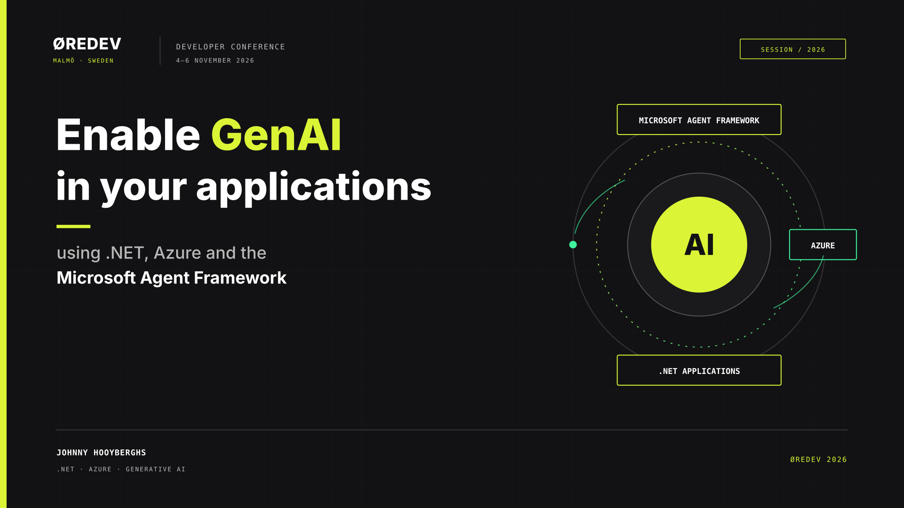
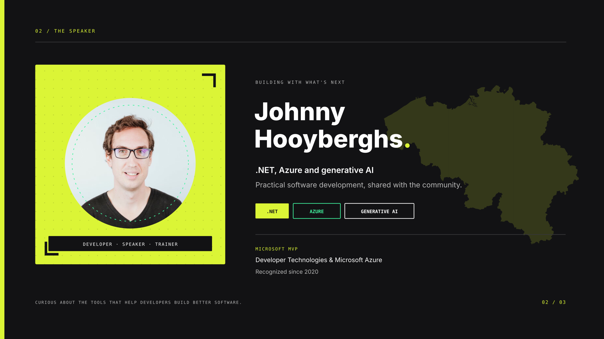
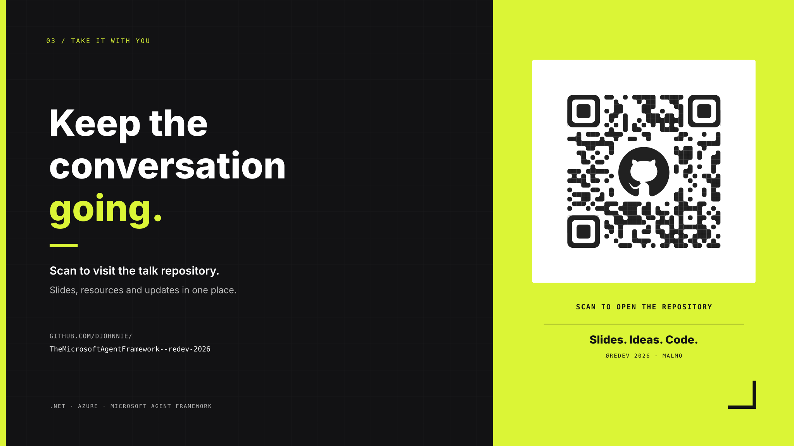

# Enable GenAI in Your Applications

**Johnny Hooyberghs · Øredev 2026 · Malmö, Sweden**

This repository accompanies the talk **“Enable GenAI in your applications using .NET, Azure and the Microsoft Agent Framework.”** It introduces a practical path from familiar .NET applications to generative AI, cloud services, and agentic workflows.

Open the [offline slide preview](_slides/index.html) to navigate the first three slides with the arrow keys, or browse the individual slides below. Each slide includes a short takeaway and an explanation of its place in the presentation.

## Presentation slides

### Slide 1 / Enable GenAI in your applications

> **TL;DR:** Build GenAI into your applications with .NET, Azure, and the Microsoft Agent Framework.

The opening slide introduces Johnny Hooyberghs's Øredev 2026 session and its focus: **Enable GenAI in your applications using .NET, Azure and the Microsoft Agent Framework**. A central AI mark is connected to the application, cloud, and agent-framework labels, framing the talk around the technologies working together.

The visual identity follows Øredev's near-black and electric-lime palette, with Geist Mono, Inter, and Outfit typefaces. The 16:9 SVG is designed to be readable on a presentation screen.

### Slide 2 / Johnny Hooyberghs

> **TL;DR:** Meet your guide to building with .NET, Azure, and generative AI.

The speaker introduction positions Johnny Hooyberghs as a developer, speaker, and trainer focused on practical software development. The .NET, Azure, and generative AI labels preview the areas brought together in the session.

Microsoft MVP recognition in Developer Technologies and Microsoft Azure, held since 2020, adds context to the speaker's community and technology background. A subtle silhouette of Belgium appears behind the text, recolored in Øredev's electric lime to complement the portrait and the slide's dark theme.

### Slide 3 / Scan to visit the repository

> **TL;DR:** Scan the QR code to open this repository and follow along.

A large QR code links directly to the [presentation repository](https://github.com/Djohnnie/TheMicrosoftAgentFramework--redev-2026), where attendees can revisit the slides, resources, and updates. The code is embedded as a local SVG asset and is also clickable in the slide.

The split lime-and-charcoal layout makes the call to action easy to spot from the room, while the repository address is printed alongside the code for people viewing the deck on screen.
